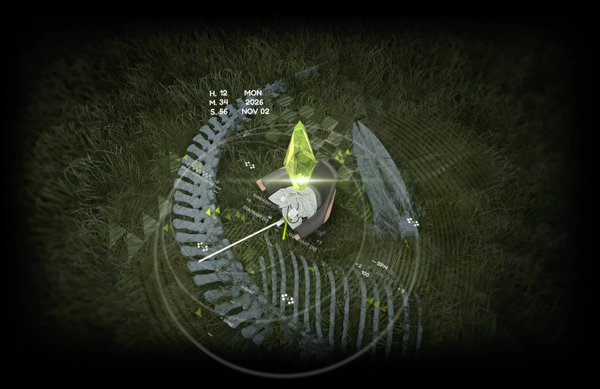

# 凯尔希动态壁纸 · macOS

《明日方舟》主题的 Mac 动态桌面、锁屏背景与屏幕保护程序，带与系统时间同步的时钟。

**当前正式版：1.1（发布标签 `v1.1.0`，build `20261028061524`）。**

[下载 ZIP](https://github.com/Hastur-02/KaltsitWallpaper/releases/download/v1.1.0/KaltsitWallpaper-v1.1.0-macOS-arm64.zip) · [Release 页面](https://github.com/Hastur-02/KaltsitWallpaper/releases/tag/v1.1.0) · [SHA-256 校验值](SHA256SUMS)

## 画面

桌面使用草地与 Mon3tr 骨架背景；锁屏和屏保使用暗色地面、晶簇与彩色光柱。




以上是应用自身渲染的画面，不包含 macOS 登录界面。

## 1.1 版的过渡

- 锁屏时，桌面在约 **0.4 秒**内收回至白色房间的椅子帧；锁屏屏保从椅子帧展开暗色场景，入场约 **2 秒**。
- 锁屏中准备解锁时，暗色屏保快速收回；解锁后桌面重新展开草地。
- 常态背景以 20 秒周期循环，时钟指针、数字时间和日期由程序实时绘制。
- 提供菜单栏控制、登录自启、屏保安装与卸载恢复功能。

## 系统要求

- Apple Silicon Mac（`arm64`）。
- macOS 14.0 或更高版本。
- 本包不包含 Intel 版本。

## 安装

1. 从本仓库的 Release 下载 ZIP 并解压。
2. 双击包内的 `install.command`。如果系统拦截脚本，可在终端中输入 `zsh `，再把该脚本拖入终端并回车。
3. App 安装到 `~/Applications/KaltsitWallpaper.app` 并启动。首次启动会设置登录自启、安装屏保，并将系统桌面底图和锁屏屏保设置为凯尔希。

这是本地签名版本，未经过 Apple 公证。安装脚本会校验应用签名，仅移除所安装 App 的下载隔离标记，并保留已有 App 的备份。

也可以将 `KaltsitWallpaper.app` 拖入“应用程序”后打开。若 macOS 拦截，请在“系统设置 → 隐私与安全性”中处理这份应用的打开提示。

菜单栏时钟图标中可重播入场、打开屏保设置、退出或卸载。退出仅停止壁纸程序；完整卸载请使用菜单中的“卸载…”或包内 `uninstall.command`。

## 校验下载

将 ZIP 和 Release 中的 `SHA256SUMS` 放在同一目录，运行：

```sh
shasum -a 256 -c SHA256SUMS
```

包内 `VERSION.json` 记录应用版本、构建号及两个可执行文件的 SHA-256。此发布使用原始 1.1 成品；发布前校验了代码签名、版本、二进制一致性与 ZIP 完整性。未进行跨机型和跨 macOS 版本的兼容性测试。

## 已知限制

- 视频以 3024×1964 制作，其他屏幕比例会按填充方式裁切边缘。
- macOS 决定桌面、锁屏和屏保的交接时机；不同系统版本上的过渡可能不同。
- 心率与步数在 Mac 上没有数据来源，显示 `--`；电量来自本机电池。
- 锁屏设置会替换当前系统壁纸与屏保，卸载时尝试恢复安装前记录的设置。

本仓库提供 1.1 版成品、安装脚本、预览与发布记录，不包含应用及素材重建源码。

画面和美术素材来自《明日方舟》，相关权利归原权利人所有。
